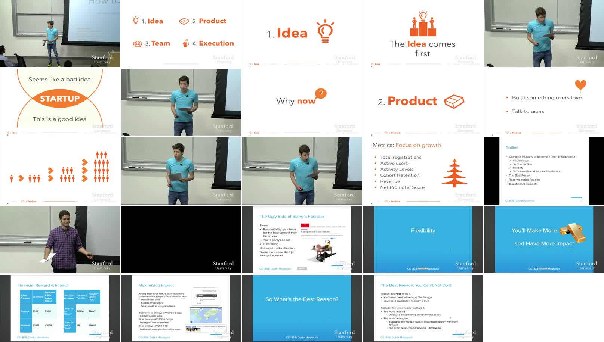

# video-context

A Claude Code skill that loads a video into Claude's context: title, channel, description,
chapters and a timestamped transcript, plus key frames when you want them.

It works with YouTube, Instagram, TikTok, X, Vimeo and
[everything else yt-dlp supports](https://github.com/yt-dlp/yt-dlp/blob/master/supportedsites.md),
and with local video and audio files. Runs on Windows, macOS and Linux.

```
/video-context https://youtu.be/CBYhVcO4WgI what does he say about metrics?
/video-context ~/Videos/meeting.mp4 summarize the decisions
```

You don't have to type the command: paste a video link and ask about it, and Claude picks the
skill on its own.

---

## Contents

- [Example](#example)
- [Install](#install)
- [How it works](#how-it-works)
- [Options](#options)
- [Output](#output)
- [Logins and cookies](#logins-and-cookies)
- [Long videos, progress and stopping](#long-videos-progress-and-stopping)
- [Exit codes](#exit-codes)
- [Troubleshooting](#troubleshooting)
- [Limitations](#limitations)

---

## Example

A real run on Linux with an RTX 3090, after the one-time setup.

```
/video-context https://www.youtube.com/watch?v=CBYhVcO4WgI --frames
```

[Lecture 1 – How to Start a Startup](https://www.youtube.com/watch?v=CBYhVcO4WgI) (Sam Altman,
Dustin Moskovitz), Y Combinator / Stanford CS183B, 43:53.

- **Transcript:** the creator's English subtitles, with the 20 chapters as headings.
  2.8 s without `--frames`.
- **Frames:** 24 frames in 33 s, most of it downloading the 720p video. Because frames are taken at
  chapter starts, nearly every one lands on that chapter's slide.



Output, with the transcript shortened to its first paragraphs:
[`examples/yc-lecture/context.md`](examples/yc-lecture/context.md).
The grid was made for this README; the skill saves each frame as a separate file.

### What's saved

```
~/Downloads/video-context/youtube-CBYhVcO4WgI/
├── context.md      57 KB   metadata, chapters, description, frame list, full transcript
├── info.json      159 KB   the same as data (transcript as [seconds, text] pairs)
├── frames/        1.2 MB   24 × f_00h00m01s.jpg … f_00h42m19s.jpg
├── status.json             {"state": "done", ...}
└── progress.log
```

The video itself isn't kept: it was downloaded only to take the frames, then deleted. Add `--video`
to keep it. For a video without captions, the folder also holds `stt_full.jsonl`, the
speech-to-text segments.

<sub>Example video: "How to Start a Startup", Lecture 1, by Y Combinator, used under its
[Creative Commons license](http://creativecommons.org/licenses/by-nc-nd/2.5/). Excerpts are shown
unmodified, with attribution.</sub>

---

## Install

### 1. Install uv

[uv](https://docs.astral.sh/uv/) is the only requirement. It provides Python and every package the
skill needs, in an isolated environment that never touches your system Python.

| OS | Command |
|---|---|
| macOS / Linux | `curl -LsSf https://astral.sh/uv/install.sh \| sh` (or `brew install uv`) |
| Windows | `powershell -ExecutionPolicy ByPass -c "irm https://astral.sh/uv/install.ps1 \| iex"` (or `winget install astral-sh.uv`) |

If uv is missing when the skill runs, Claude asks before installing it.

### 2. Install the skill

From the repo root:

```bash
python install.py video-context           # symlink into ~/.claude/skills/
python install.py video-context --copy    # or copy it
python install.py video-context --project # or install for the current project only
```

Or copy this folder to `~/.claude/skills/video-context/` by hand. Start a new Claude Code session
afterwards.

### First run

| When | What's downloaded | Size | Time |
|---|---|---|---|
| First use | Python (if needed), yt-dlp, ffmpeg, deno | ~100 MB | 10–20 s |
| First video without captions | faster-whisper + the `small` speech model | ~650 MB | 1–3 min |
| First speech-to-text on an NVIDIA GPU | CUDA libraries (cuBLAS, cuDNN) | ~1 GB | 1–2 min |

Everything is cached by uv and reused afterwards. A system `ffmpeg` is used if one is installed;
otherwise a bundled copy.

---

## How it works

```
input (URL or file)
   │
   ├─ metadata ─────────── title, channel, date, duration, views, description, chapters, tags
   │
   ├─ transcript ───────── first source that exists:
   │                         1. creator subtitles
   │                         2. auto-captions (original language only)
   │                         3. local file: sidecar .srt/.vtt, or subtitles embedded in the file
   │                         4. speech-to-text (only when none of the above exist)
   │
   ├─ frames (optional) ── key frames as JPGs
   │
   └─ context.md ───────── everything above, printed into Claude's context
```

### Transcript

- **Language:** the video's original language first, then English. `--lang` picks another.
  YouTube's machine-translated captions are never used.
- **Cleanup:** YouTube auto-captions repeat every line two or three times; the duplicates are
  removed. Lines are grouped into paragraphs of about 30–45 seconds, each starting with a `[mm:ss]`
  timestamp, with chapter headings in between.
- **Sponsors:** on YouTube, sponsor segments from [SponsorBlock](https://sponsor.ajay.app/) are
  labelled `[SPONSOR]`, `[SELF-PROMO]` or `[SUBSCRIBE-REMINDER]`, so they don't skew a summary.
  The lookup is private: SponsorBlock only receives the first 4 characters of a hash of the video
  ID, which many videos share. `--no-sponsorblock` skips it.

### Speech-to-text

Used only when a video has no captions of any kind. In practice that means Instagram, TikTok,
local recordings, and the occasional YouTube video.

- **Model:** [faster-whisper](https://github.com/SYSTRAN/faster-whisper) `small`, int8. Detects the
  language automatically and skips silence and most background music.
- **Device:** an NVIDIA GPU with at least 1.5 GB of *free* VRAM (the one with the most free memory
  is used), otherwise the CPU. If the GPU fails to load, it falls back to the CPU. macOS always
  uses the CPU.
- **Speed:** about 1 hour of audio in 1–2 minutes on a GPU, 5–10 minutes on a CPU.
- **Saved as it goes:** each segment is written as soon as it's transcribed, so a stopped run keeps
  its work and the next run continues from there.

### Frames

Off by default; turn on with `--frames`. Each frame is a 720p JPG named by its timestamp. By
default the skill picks 6 frames for a short reel, rising to 25 for videos of 30 minutes or more,
taken at chapter starts and scene changes and filling the largest gaps; near-identical frames are
dropped. `--every`, `--at` and `--max-frames` override this.

Claude doesn't look at every frame. It opens the ones that matter for your question.

> More frame-selection techniques are planned and will be documented here.

---

## Options

| Option | What it does |
|---|---|
| **Transcript** | |
| `--lang xx` | Preferred transcript language, e.g. `en`, `de`, `ja` |
| `--stt` | Use speech-to-text even if captions exist |
| `--no-stt` | Never use speech-to-text |
| `--device cpu\|cuda` | Force the speech-to-text device (a forced `cuda` fails instead of falling back) |
| `--yes` | Don't stop to ask before long speech-to-text |
| **Frames** | |
| `--frames` | Extract key frames |
| `--max-frames N` | Change the number of frames |
| `--every SEC` | One frame every SEC seconds instead |
| `--at 1:23,4:56` | Frames at exactly these times |
| `--scene 0.3` | Scene-change sensitivity, 0–1 (lower catches smaller changes) |
| **Scope and extras** | |
| `--range 10:00-25:00` | Only this section, for speech-to-text, frames and saved files (a transcript from captions is not trimmed) |
| `--video` | Also save the video (mp4) |
| `--audio` | Also save the audio (mp3) |
| `--comments N` | Include the top N comments |
| `--no-sponsorblock` | Don't label sponsor segments |
| **Login** | |
| `--cookies-from-browser B[:PROFILE]` | Use this browser's login from the start, e.g. `firefox` |
| `--no-cookies` | Never use browser cookies |
| **Run control** | |
| `--out DIR` | Base output folder (default `~/Downloads/video-context`) |
| `--refresh` | Ignore cached results and fetch again |
| `--clean` | Delete cached output for this video, or for all videos if no input is given |
| `--max-time 30m` | Give up after this long |
| `--stop <url\|id\|file>` | Stop a running job |
| `--stop-all` | Stop all running jobs |
| `--update` | Upgrade yt-dlp |
| `--version` | Show tool versions |

Any of `--max-frames`, `--every` or `--at` turns on `--frames`.

Times can be written as `1:23:45`, `12:34`, `754`, `754s` or `12m34s`.

To run it without Claude:

```bash
uv run scripts/video_context.py "https://youtu.be/..." --frames
```

---

## Output

One folder per video, in `~/Downloads/video-context/` unless you set `--out`:

| Input | Folder |
|---|---|
| URL | `<site>-<video id>`, e.g. `youtube-CBYhVcO4WgI` |
| Local file | `local-<file name>-<hash>`, e.g. `local-meeting-393ee156` |

Nothing is ever written next to your own files.

```
youtube-CBYhVcO4WgI/
├── context.md            the main output (see below)
├── info.json             same data, machine-readable; also the cache
├── frames/               f_00h03m48s.jpg ...          (with --frames)
├── stt_full.jsonl        speech-to-text segments       (when used)
├── video.mp4             (with --video)
├── audio.mp3             (with --audio)
├── status.json           state, stage, progress, ETA
├── progress.log
└── stt.log
```

The video itself isn't kept unless you pass `--video` or `--audio`. Files downloaded for frames or
speech-to-text are deleted when the run ends.

### context.md

```markdown
# Video context: Youtube CBYhVcO4WgI

<untrusted-content source="metadata">
Title: Lecture 1 - How to Start a Startup (Sam Altman, Dustin Moskovitz)
By: YC Root Access
Tags: startup, class, CS183B, Y Combinator, Sam Altman
</untrusted-content>

- **URL:** https://www.youtube.com/watch?v=CBYhVcO4WgI
- **Uploaded:** 2014-09-23
- **Duration:** 43:53
- **User linked to:** 24:38 (focus around this point)
- **Transcript:** Youtube creator subtitles (en)

## Chapters
<untrusted-content source="chapters">
- [00:00] Introduction
- [02:10] The 4 Areas of Success
...
</untrusted-content>

## Description
<untrusted-content source="description"> ... </untrusted-content>

## Frames (24)
- [00:01] .../frames/f_00h00m01s.jpg
...

## Transcript
<untrusted-content source="transcript">
#### [00:00] Introduction

[00:00] Welcome. Can I turn this on? Maybe, all right. ...
</untrusted-content>
```

- Everything the uploader controls (title, channel, tags, chapter titles, description, comments,
  transcript) is wrapped in `<untrusted-content>`. Claude is told to treat it as data, never as
  instructions, and any text inside that tries to close the block is neutralised.
- **Large transcripts:** if `context.md` is over about 20,000 tokens, only the header is printed,
  with an index of the line where each chapter starts. Claude then reads just the parts it needs.
- **Re-running** the same video reuses the saved results and returns instantly. Adding an option
  such as `--frames` only does the new work.

---

## Logins and cookies

Public videos never touch your browser. Some sites block downloads without a login (Instagram does
often; YouTube does for age-restricted or members-only videos). When that happens:

1. The skill finds the browsers installed on your computer, and each of their profiles.
2. It checks which ones are logged in to that site.
3. Then:
   - **one** is logged in → it uses that browser's cookies and **tells you which one**
     (`context.md` also records it);
   - **several** are → Claude asks you which to use;
   - **none** are → it stops and says which browsers it checked.

Cookie values are never printed, logged or saved, and the choice isn't remembered: the next run
starts without cookies again.

Supported browsers: Firefox, Chrome, Chromium, Edge, Brave, Opera, Vivaldi, Whale, Safari
(including Snap and Flatpak installs on Linux).

| OS | Note |
|---|---|
| Windows | Chrome and Edge cookies are often unreadable (Chrome's app-bound encryption), and the browser must be fully closed. Firefox always works. |
| macOS | Chrome-family browsers show a Keychain prompt, so Firefox and Safari are checked first. Safari needs Full Disk Access for your terminal app (System Settings › Privacy & Security). |
| Linux | Chrome-family cookies are decrypted with the desktop keyring, which doesn't always work. Firefox always does. |

A browser whose cookies can't be decrypted is reported as "couldn't read", not "not logged in".

Using your logged-in account with a download tool carries a small risk of the site rate-limiting
or flagging that account.

---

## Long videos, progress and stopping

- **Captions don't depend on length.** A 3-hour YouTube video with captions takes a few seconds.
- **Long speech-to-text asks first.** Over 20 minutes of audio without captions, the skill estimates
  the time and Claude asks whether to transcribe it all, only a section (`--range`), or skip it.
- **Background runs.** Claude runs slow jobs (speech-to-text, frames, saving video) in the
  background. Ask "how's it going?" and it reads `status.json`.
- **Stopping.** Tell Claude to stop. It ends the job and every process it started (download,
  ffmpeg, speech-to-text), deletes half-downloaded files and keeps finished work. Pressing Esc in
  Claude Code does **not** stop a background command.
- **Resuming.** Run the same request again: speech-to-text continues where it stopped.
- **One job per video.** A second run on the same video while one is going is refused.

---

## Exit codes

For running the script directly:

| Code | Meaning | Output starts with |
|---|---|---|
| 0 | Done | The context, ending with `CONTEXT_FILE: <path>` |
| 1 | Failed, with the reason | `FAILED:` |
| 2 | Invalid arguments, e.g. a malformed `--range` | `error:` (from the argument parser) |
| 3 | Needs a decision (which browser, or long speech-to-text) | `NEEDS_INPUT`, followed by the exact flags to choose from |
| 130 | Stopped; partial results kept | `STOPPED:` |

---

## Troubleshooting

| Problem | Try |
|---|---|
| A site that used to work fails | `--update`. Sites change often and break older yt-dlp versions. The skill also upgrades and retries once on its own when an error looks like this. |
| "needs a login" | Log in to the site in Firefox, then try again. |
| "couldn't read" a browser's cookies | Close that browser fully, or use Firefox. |
| Rate-limited | Wait a few minutes. |
| Speech-to-text uses the CPU although you have a GPU | Another program may be using the GPU's memory (it needs 1.5 GB free). The reason is shown in the log. `--device cuda` forces it. |
| Transcript has misheard names | Expected with auto-captions and speech-to-text. Check important quotes against the video. |
| No transcript at all | The video has no speech (music, silent reel). Use `--frames`. |

---

## Limitations

- One video at a time; playlists, channels and multi-video posts aren't supported.
- Live streams can't be processed until they've ended.
- Speech-to-text needs some speech; music-only videos produce no transcript.
- Frames show what's on screen at chosen moments. They can miss brief changes between frames.
- Tested on Linux. Windows and macOS are supported by design but not yet tested.

Only download what you're allowed to. Platform terms and copyright still apply.

## License

MIT, see [LICENSE](../../LICENSE).
